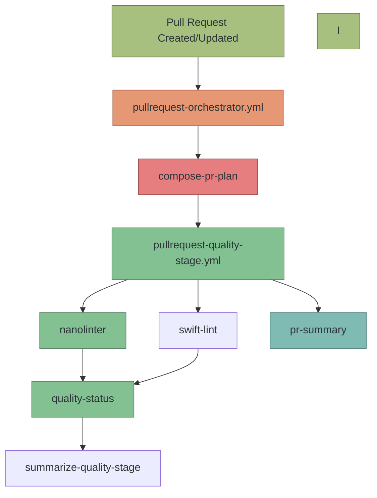
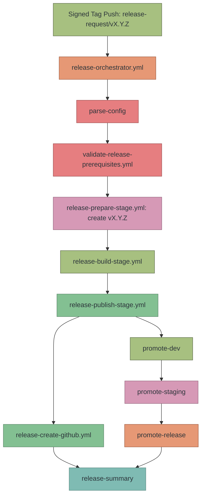
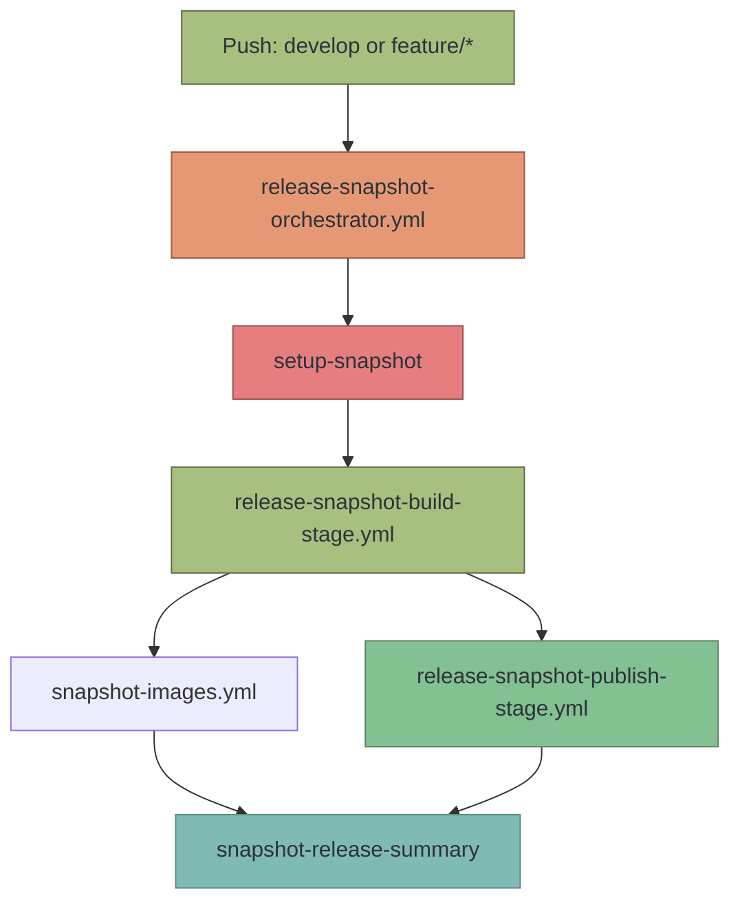
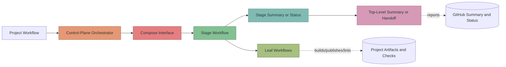

# Workflow Architecture and Patterns

For workflow design rules, see [Workflow Design Policy](workflow-design-policy.md).
For the authoritative workflow inventory and direct-call contracts, see
[Components Reference](components.md).

## Pull Request Workflow Architecture

Primary high-level entry point: `pullrequest-orchestrator.yml`

The pull request flow follows the same control-plane pattern as release and snapshot:

1. `compose-pr-plan`
2. `execute-quality-stage`
3. `pr-summary`

The PR plan carries project/base-branch context, quality-policy flags, and the quality-stage target plan.
The quality stage owns lint/security fanout and produces one stage result contract.
The top-level summary job consumes the quality stage result and writes a GitHub Step Summary.



### PR Stage Responsibilities

- `pullrequest-orchestrator.yml` owns PR order, plan handoff, and top-level summary
- `pullrequest-quality-stage.yml` owns quality check fanout and quality-stage result normalization
- leaf `lint-*` and `security-*` workflows stay focused on one check each

### PR Plan Contract

The PR orchestrator produces typed JSON payloads that drive the quality stage:

**`pr-plan-json`**: runtime context, policy, and stage plans:

| Field | Source | Purpose |
|-------|--------|---------|
| `context.project_type` | `inputs.project-type` | Project ecosystem (`maven`, `npm`, `gradle`, `gradle-android`, `xcode-ios`, `cargo`, or `go`) |
| `context.base_branch` | `inputs.base-branch` or PR target | Base branch for commit linting |
| `context.forge_ci_binary_ref` | `inputs.forge-ci-binary-ref` | `forge-ci` binary revision used by plain-runner jobs |
| `policy.nanolinter_image` | `inputs.nanolinter-image`, or derived from `project-type` | Image the nanolinter job runs in (`ghcr.io/itiquette/nanolinter:<flavour>`; `core` when the type has no flavour). Verify publication and pin the served digest before activation; see [lint images](components.md#lint-nanolinteryml-default). |

**`quality-stage-plan-json`**: quality check target plan:

| Target | Default | Purpose |
|--------|---------|---------|
| `targets.nanolinter.runs` | `true` | Run nanolinter, the default lint engine (`lint-engine: nanolinter`) |
| `targets.megalinter.runs` | `false` | Run MegaLinter, the alternative engine (`lint-engine: megalinter`); mutually exclusive with nanolinter |
| `targets.swift.runs` | derived | `true` if either Swift linter is enabled (runs standalone on macOS, orthogonal to the lint engine) |

### Stage Result Contract

Stage workflows use `forge-ci report stage-result` to turn a typed stage
plan and job results into normalized outputs. GitHub stage workflows pass
`JOB_RESULTS: ${{ toJson(needs) }}`. The CLI also accepts explicit `target=result`
pairs or per-job records collected from the report store:

```json
{
  "version": 1,
  "stage": "build|dev-build|prepare|publish|dev-publish|pr-quality",
  "result": "success|failure|cancelled|skipped",
  "ran": true,
  "targets": {
    "target_name": "success|failure|cancelled|skipped"
  }
}
```

Targets whose stage-plan `runs` flag is `false` are rendered as `"skipped"`.
For planned targets, explicit `--result` values must be `success`, `failure` or
`cancelled`; unknown values and `skipped` are rejected. `report job-result` and
needs-map parsing normalize unknown runner statuses to failure. A missing
planned job record becomes a failure, while a missing explicit `target=result`
pair is an input error.

The stage `result` is `"failure"` if any running target failed, `"cancelled"` if
any was cancelled and none failed, otherwise `"success"`. When no targets ran,
the stage result is `"skipped"` and `ran` is `false`. Summary commands validate
non-empty `result-json` values and reject unsupported versions or malformed target
results instead of treating broken JSON as a clean skip.

`report job-result` and `report stage-result` compose records and outputs.
Successful execution means those writes succeeded, even when the recorded
result is `failure`. A pipeline gate must consume `stage-result` or the result
JSON and preserve the original job's failure; the reporter's exit code alone
is not the stage verdict.

#### File-based report handoff

`CI_RESULTS_DIR` selects local storage, defaulting to `.ci-results`:

- `report job-result` writes `jobs/<name>.json` beneath that root.
- `report stage-result` collects those files when neither explicit results nor
  a job-results map is supplied, and writes `<stage>-result.json` in the root.
- The workflow must upload the producer records and restore them in the
  downstream job using its native artifact transport. Neither command transfers
  files between jobs.

Use a fresh result root for each run/stage and collect only its trusted job
records. Records identify the job and result, not the run or stage; reusing a
directory can reuse an old success. Supply the typed stage plan through
`--stage-plan-json` or `STAGE_PLAN_JSON` when aggregating. A missing planned
record becomes a failure result; file presence does not establish its origin
or freshness.

### Artifact Transfer Contract

Release creation and snapshot SBOM aggregation use `artifact-transfer-plan-json` to
download exact CI artifact names instead of wildcard patterns. The contract is
versioned independently from release/snapshot plans:

```json
{
  "version": 1,
  "items": [
    {
      "kind": "build_artifact|build_sbom|analyzed_container_sbom|extracted_binaries",
      "name": "app-build-artifacts",
      "path": "./release-artifacts/",
      "required": true
    }
  ]
}
```

An item must set exactly one of `name` or `name_template`. The only template
placeholder is `{run_id}`, used for per-run analyzed-container SBOM uploads.

Release creation does not rediscover each later fileset independently. After
planned artifact downloads and release SBOM generation, `release-create-github.yml`
runs `forge-ci release assemble` to stage the canonical release tree and write
`.forge-ci/release-assembly.json`:

- final release assets are copied under `release-files/assets/`
- SBOM inputs are copied under `release-files/sboms/`
- `release sbom-zip`, `release checksums`, `release sign`, and
  `release publish --strategy=recreate` consume the same manifest through
  `--assembly`; the recreate strategy requires it and uploads nothing else

The release asset namespace is intentionally flat by basename. Duplicate final
asset names fail closed instead of letting a forge overwrite one file with
another. Image promotion hand-off files such as `release-images.json` and
`release-images-ledger*` are excluded from release assembly; promotion workflows
consume those ledgers separately.

### Release Workflow Architecture

Primary high-level entry point: `release-orchestrator.yml`

The workflows shown underneath are mostly helpers used by the orchestrator. Several can still be used directly by advanced consumers who need finer control.

The current production release flow is intentionally stage-based:

1. Validate and derive the signed `release-request/vX.Y.Z` ref
2. `parse-config`
3. `validate-prerequisites`
4. `execute-prepare-stage` creates the final `vX.Y.Z` tag
5. `execute-build-stage` checks out that final tag
6. `execute-publish-stage` checks out that final tag
7. `create-release` and the `promote-dev` → `promote-staging` →
   `promote-release` ladder run from the published build evidence
8. `release-summary` joins release creation and all promotion outcomes

The public orchestrator now acts as the release control plane. Build and publish fanout live one layer lower in stage-level reusable workflows.
Release preparation now follows the same pattern through `release-prepare-stage.yml`.



### Release Stage Responsibilities

- `release-orchestrator.yml` owns release order, policy handoff, and top-level stage readability
- `release-prepare-stage.yml` owns version-bump fanout and prepare-stage result normalization
- `release-build-stage.yml` owns build fanout and build-stage result normalization
- `release-publish-stage.yml` owns publish fanout and publish-stage result normalization
- `release-create-github.yml` owns release-file assembly, SBOM ZIP creation, checksums, signing, and platform release upload
- leaf `build-*` and `publish-*` workflows stay focused on one ecosystem or destination each

The exact leaf inventory belongs to [Components Reference](components.md), not
this architecture page.

Build artifact upload names are part of the typed plan contract. Maven, NPM, and
Gradle matrix builds upload `<artifact-name>-build-artifacts` and
`<artifact-name>-build-sbom`; Go artifact-first builds upload
`<artifact-name>-go-build-artifacts` and `<artifact-name>-go-build-sbom`.
Publish/container/release jobs consume the plan-provided names instead of
reconstructing ecosystem defaults in workflow YAML.

### Stable and prerelease policy

All three forge release layers use `release-policy`:

| Value | Accepted signed requests |
| --- | --- |
| `stable` (default) | `release-request/v1.0.0` |
| `stable-prerelease` | Stable requests and versions such as `release-request/v1.0.0-beta.2` or `release-request/v1.0.0-rc.1` |

The signed version determines classification; the policy only admits it.
This replaces `release-type` and `derive-release --require-stable`, without
aliases. Invalid policies, malformed
versions and build metadata are rejected. Keep the selected policy in trusted
workflow configuration; GitLab takes it from the external release policy, and
Forgejo must pass the same value to prepare and sign/publish workflows.
Use a Forge CI binary and runtime images from the same feature release as the
workflows; older binaries fail on the new explicit policy flag.

Prereleases use the same declared builds, signing backend, checksums, SBOMs
and provenance as stable releases. They are immutable numbered releases, not
rolling snapshots: matching published content is a retry success; conflicting
content is refused. Draft publication remains an independent setting.

On GitHub, signing and publication are separate jobs. The signer uploads a
digest-bound checkpoint, including signatures, notes and assembly metadata.
A failed publisher reuses that exact checkpoint and revalidates the prepared
tag before publication; it receives no signing key or OIDC permission.

Notes are cumulative from the preceding stable release, so beta tags do not
truncate the eventual stable notes. Prerelease images use version-specific
tags; stable aliases and the GitHub stage-promotion ladder are not advanced.

GitHub and Forgejo set their native prerelease flag. GitLab has no equivalent
flag: the release notes identify the prerelease, and version-specific download
links must be used. Its native latest-release permalink is date-based and can
point at a beta. Forge CI does not alter timestamps to hide this difference.

Destination compatibility is checked before release preparation. Prereleases
cannot target Google Play's production track; testing tracks remain available.
iOS prereleases are rejected until numeric marketing-version mapping is
supported. Mutable Maven `-SNAPSHOT` versions cannot enter immutable package
publication; ordinary beta/RC Maven versions are supported.

### Image Promotion Ladder

`publish-container.yml` uploads a run-scoped image ledger. Three calls to
`promote-stage.yml` then move the same digest through the environment pointers:

1. `promote-dev` moves `:dev` automatically.
2. `promote-staging` waits on the configured staging environment.
3. `promote-release` waits on the production environment and may set
   `stage-repo` for a sovereignty/cross-registry destination.

Every rung verifies the candidate digest before and destination digest after the
copy. Same-repository copies use the in-process OCI client. Cross-repository or
cross-registry copies use `cosign copy`, carry signatures, preserve the source
repository path under the destination prefix, and require destination registry
credentials. A failed rung leaves verified pointers for a forward retry rather
than guessing at rollback ownership. See [Artifact and Image
Flows](flows.md#stage-ladder-and-registry-routing) for the domain rules.

### Snapshot Release Workflow Architecture

Primary high-level entry point: `release-snapshot-orchestrator.yml`

The snapshot release flow follows the same lighter control-plane pattern:

1. `setup-snapshot`
2. `execute-snapshot-build-stage`
3. `execute-snapshot-publish-stage`
4. `snapshot-images.yml` after artifact builds, alongside package publication
5. `snapshot-release-summary`

The snapshot path skips release creation and signing. Declared containers publish
by default; `publish-containers: false` is the explicit opt-out. Source-only and
container-only configurations are accepted. There is no implicit root
Containerfile discovery for snapshots. Package SBOM generation defaults to `none`
and is selected with `sboms`; image SBOMs follow container policy independently.
It still benefits from one small control-plane interface job so later stage calls depend on `snapshot-release-plan-json`, `snapshot-build-stage-plan-json`, and `snapshot-publish-stage-plan-json` instead of shell-derived context bags.
The snapshot publish stage plan includes explicit singleton `inputs` for non-matrix jobs: NPM publish, Cargo SBOM, and Go SBOM. Workflow YAML therefore never indexes into plan arrays.
Those singleton inputs include the exact NPM build artifact upload name used by the snapshot build stage.

**Idempotent NPM publishing:** Snapshot versions are content-addressed (`{base}-snapshot-{branch}-{sha}`), so the same commit always produces the same version string. The `publish-snapshot-npm.yml` workflow checks the registry before publishing and skips with a warning if the version already exists. This makes re-runs safe: the pipeline succeeds without attempting to overwrite an immutable package.

#### Snapshot container contract (all three forges)

`forge-ci container snapshot-images` owns planning, artifact production, context
validation/restoration, image builds, publication and collection. The logical
branch is explicit, including manual
developer-branch selection; resolve it once and build from the frozen source SHA.
Container tags always include a hash of the original branch, even when its
normalized name is unique, and end in lower-case `-snapshot`:
`1.2.3-feature-login-<branchhash>-a1b2c3d-snapshot`.
This avoids normalized-branch collisions; package version conventions are unchanged.
Architecture staging tags may append `-amd64` or `-arm64` to that final image tag.

Native `linux/amd64` and `linux/arm64` builds stage OCI layouts without registry
publication credentials. Publication waits for **all** planned builds, verifies
the complete platform set, then scans according to `enable-scan` and
`scan-severity`. `enable-analyzed-container-sbom` independently selects image
SBOM generation. Signing is `NONE`; explicit OCI signing or `enable-slsa: true`
requests are rejected. Snapshots never update stable aliases or enter promotion.

The GitHub root orchestrator calls `snapshot-images.yml` after artifact builds,
passing their frozen SHA and `use-build-artifacts: true` to reuse the exact
same-run uploads without rebuilding. Its public additions are:

| Interface | Purpose |
| --- | --- |
| `publish-containers` | Boolean, default `true`; explicit `false` opts out |
| `container-image-repository` | Optional base OCI repository; defaults to `<registry>/<owner>/<repository>` |
| `container-registry-user` | Optional registry username; defaults to the GitHub actor |
| secret `container-registry-password` | Optional OCI credential; GHCR uses the GitHub token when omitted |
| output `container-images-json` | Exact collected image inventory with source identity, platforms and immutable digest refs |

The standalone GitHub `snapshot-images.yml` takes required `branch`, optional
`source-sha`, `image-repository`, `registry-user` and secret `registry-password`.
Without `source-sha`, it resolves the selected branch once. With it, it checks
out that exact commit while retaining the logical branch for naming.
Its `use-build-artifacts` default is `false`: required artifact-first producers
run automatically. Optional `runtime-image-go`, `runtime-image-java`,
`runtime-image-node` and `runtime-image-rust` select their toolchain runtimes.
Collection rejects missing, duplicate, extra or source/platform-mismatched receipts;
no declarations or an explicit opt-out produce an empty inventory.

#### Automatic artifact-first inputs

The shared plan carries required `artifacts[]` and frozen `source_date_epoch`.
`build-artifact` invokes the existing Go, Cargo, Maven, Gradle JVM and npm builders
with the typed artifact settings, source SHA, snapshot package version and source
timestamp. Ecosystem settings such as Go build tags/ldflags/main package, Java
profiles/tasks/settings, Node version and opted-in private dependencies follow
those builders. Providers supply toolchains and native job/artifact transport;
Go owns the business rules and validation.

| Command | Handoff |
| --- | --- |
| `build-artifact` | Build one planned producer, or prepare its exact download with `--from-artifact` |
| `prepare-inputs` | Convert existing exact build uploads to producer outputs without rebuilding |
| `gather-context` | Validate the complete producer set, install planned inputs and emit a frozen context bundle |
| `restore-context` | Verify that bundle and restore only planned dependency files and inventory into the frozen checkout |

[Forgejo](forgejo.md#snapshots) and [GitLab](gitlab.md#snapshots) automatically
schedule required producer matrices by default. A same-run prepared context is
an optional advanced override. Source-only/container-only plans need no artifact
producers. Container-first compilation remains in the Containerfile.

Producer receipts and dependency inventories bind source SHA/branch, frozen plan,
artifact/image names, platforms, file paths, sizes, SHA-256 and canonical string
modes `0644`/`0755`. These modes survive ZIP transport; restoration applies the
recorded mode. Raw Go/Cargo expected binaries are normalized as executables,
without making every input file executable. `restore-context` validates the
complete bundle and destination paths in Go, confines writes to planned inputs,
and refuses source/Git/plan replacement or symlink escapes. This is run-local
integrity evidence, not a signature or independent proof of CI-run origin.

Npm inputs require exactly one valid packaged tarball and are staged at
`<context>/.forge-ci/snapshot-inputs/<name>`. A Containerfile uses a context-relative
path such as `COPY .forge-ci/snapshot-inputs/web/*.tgz /tmp/` for artifact `web`.
This isolated destination avoids overwriting checkout files or mixing packages.

Container build secrets, binary extraction and explicit snapshot OCI
signing/provenance requests remain unsupported and fail explicitly. See the
[container snapshot example](../examples/container-snapshot/).



### Component Interaction Flow



### Workflow Execution Patterns

Every release shape, whether a Maven library, an application with a container,
or multi-registry publishing, runs the **same stage skeleton**; the plan only
changes which leaf jobs each stage activates (see the release diagram above):

```mermaid
graph LR
    A[Tag Push] --> B[parse-config]
    B --> C[validate-prerequisites]
    C --> D[execute-prepare-stage]
    D --> E[execute-build-stage]
    E --> F[execute-publish-stage]
    F --> G[create-release]

    style A fill:#a7c080,stroke:#5c6a4a,color:#2b3339
    style B fill:#e67e80,stroke:#9d4f50,color:#2b3339
    style C fill:#e67e80,stroke:#9d4f50,color:#2b3339
    style D fill:#d699b6,stroke:#93647c,color:#2b3339
    style E fill:#a7c080,stroke:#5c6a4a,color:#2b3339
    style F fill:#83c092,stroke:#5c856a,color:#2b3339
    style G fill:#d699b6,stroke:#93647c,color:#2b3339
```



---
