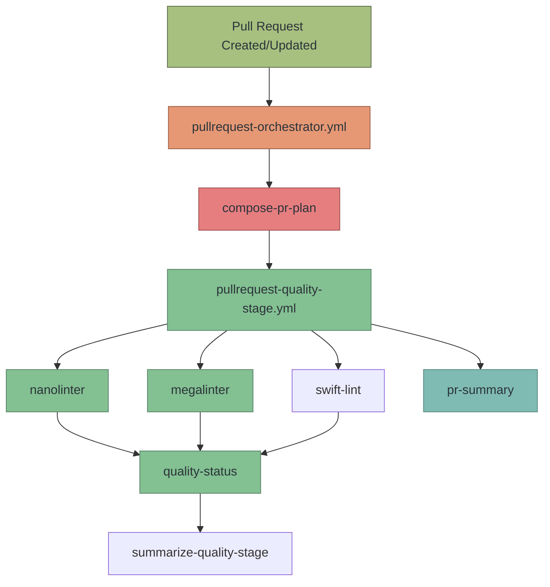
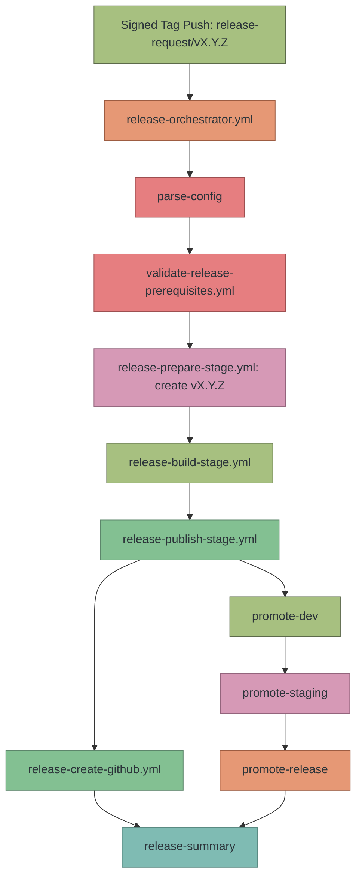
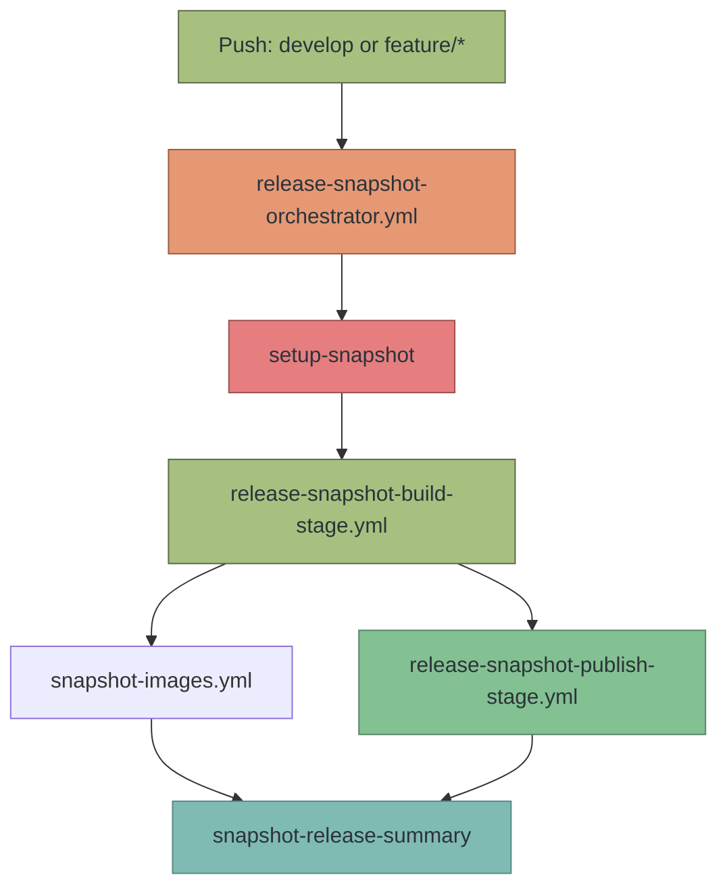

# Workflow Architecture and Patterns

For workflow design rules, see [Workflow Design Policy](workflow-design-policy.md).
For the authoritative workflow inventory and direct-call contracts, see
[Components Reference](components.md).
For administrator-owned check enforcement and the consumer trust boundary, see
[Administrator check enforcement](admin-policy.md).

## Pull Request Workflow Architecture

Primary high-level entry point: `pullrequest-orchestrator.yml`

The pull request flow follows the same control-plane pattern as release and snapshot:

1. `compose-pr-plan`
2. `execute-quality-stage`
3. `pr-summary`

The PR plan carries project/base-branch context, quality-policy flags, and the quality-stage target plan.
The quality stage owns lint/security fanout and produces one stage result contract.
The top-level summary job consumes the quality stage result and writes a GitHub Step Summary.



### PR Stage Responsibilities

- `pullrequest-orchestrator.yml` owns PR order, plan handoff, and top-level summary
- `pullrequest-quality-stage.yml` owns quality check fanout and quality-stage result normalization
- leaf `lint-*` and `security-*` workflows stay focused on one check each

### Stage Result Contract

Each stage workflow ends with `forge-ci report stage-result`, which turns the
stage plan and its jobs' results into one result JSON:

```json
{
  "version": 1,
  "stage": "build|dev-build|prepare|publish|dev-publish|pr-quality",
  "result": "success|failure|cancelled|skipped",
  "ran": true,
  "targets": {
    "target_name": "success|failure|cancelled|skipped"
  }
}
```

A target the plan does not run is `skipped`. A planned job with no record, or
with a status the CLI does not know, counts as a failure. The stage is
`failure` if any target failed, `cancelled` if one was cancelled and none
failed, `skipped` (with `ran: false`) if nothing ran, and `success` otherwise.
The reporter's exit code is not the verdict: a gate must read the result JSON.

#### File-based report handoff

`CI_RESULTS_DIR` (default `.ci-results`) is the local result store.
`report job-result` writes `jobs/<name>.json` there; `report stage-result`,
given no explicit results, collects those files and writes
`<stage>-result.json`. Neither command moves files between jobs: the workflow
uploads the records and restores them in the next job with its forge's
artifact transport. Use a fresh directory for each run and stage, since a
record names only the job and its result, and an old directory can carry an
old success.

### Release Workflow Architecture

Primary high-level entry point: `release-orchestrator.yml`

The workflows below are helpers the orchestrator calls; you can also call
them directly. [Components Reference](components.md) lists them.

The release runs in stages:

1. `resolve-bootstrap` admits the pinned engine commit and images, and
   `canonical-cli` builds the run's `forge-ci` from that commit
2. `parse-config` validates the signed `release-request/vX.Y.Z` ref and reads
   the configuration
3. `validate-prerequisites`
4. `execute-prepare-stage` creates the final `vX.Y.Z` tag
5. `validate-release-tag` checks the final tag the prepare stage pushed
6. `execute-build-stage` checks out that final tag
7. `execute-publish-stage` checks out that final tag
8. `create-release` and the `promote-dev` → `promote-staging` →
   `promote-release` ladder run from the published build evidence
9. `release-summary` joins release creation and all promotion outcomes

The orchestrator controls the order. Preparation, build and publish fan out
one layer lower, in `release-prepare-stage.yml`, `release-build-stage.yml`
and `release-publish-stage.yml`.



### Release Stage Responsibilities

- `release-orchestrator.yml` owns release order, policy handoff, and top-level stage readability
- `release-prepare-stage.yml` owns version-bump fanout and prepare-stage result normalization
- `release-build-stage.yml` owns build fanout and build-stage result normalization
- `release-publish-stage.yml` owns publish fanout and publish-stage result normalization
- `release-create-github.yml` owns release-file assembly, SBOM ZIP creation, checksums, signing, and platform release upload
- leaf `build-*` and `publish-*` workflows stay focused on one ecosystem or destination each

Release assets are named by their basename alone: two final assets with the
same name fail the release rather than overwrite each other.

### Stable and prerelease policy

All three forge release layers use `release-policy`:

| Value | Accepted signed requests |
| --- | --- |
| `stable` (default) | `release-request/v1.0.0` |
| `stable-prerelease` | Stable requests and versions such as `release-request/v1.0.0-beta.2` or `release-request/v1.0.0-rc.1` |

The signed version decides whether a release is a prerelease; the policy
only admits it. Invalid policies, malformed versions and build metadata are
refused. Keep the policy in trusted workflow configuration: GitLab takes it
from the external release policy, and Forgejo must pass the same value to the
prepare and sign/publish workflows.

Prereleases use the same declared builds, signing backend, checksums, SBOMs
and provenance as stable releases. They are immutable numbered releases, not
rolling snapshots: matching published content is a retry success; conflicting
content is refused. Draft publication remains an independent setting.

Notes are cumulative from the preceding stable release, so beta tags do not
truncate the eventual stable notes. Prerelease images use version-specific
tags; stable aliases and the GitHub stage-promotion ladder are not advanced.

GitHub and Forgejo set their native prerelease flag. GitLab has no equivalent
flag: the release notes identify the prerelease, and version-specific download
links must be used. Its native latest-release permalink is date-based and can
point at a beta. Forge CI does not alter timestamps to hide this difference.

Destination compatibility is checked before release preparation. Prereleases
cannot target Google Play's production track; testing tracks remain available.
iOS prereleases are refused. Mutable Maven `-SNAPSHOT` versions cannot enter immutable package
publication; ordinary beta/RC Maven versions are supported.

### Image Promotion Ladder

`publish-container.yml` uploads a run-scoped image ledger. Three calls to
`promote-stage.yml` then move the same digest through the environment pointers:

1. `promote-dev` moves `:dev` automatically.
2. `promote-staging` waits on the configured staging environment.
3. `promote-release` waits on the production environment and may set
   `stage-repo` for a sovereignty/cross-registry destination.

Every rung verifies the candidate digest before and destination digest after the
copy. Same-repository copies use the in-process OCI client. Cross-repository or
cross-registry copies use the same client, carry the signatures and attestations
attached to the digest (OCI referrers and cosign tags), preserve the source
repository path under the destination prefix, and require destination registry
credentials. A failed rung leaves the pointers it verified, so you retry
forward; nothing is rolled back.

### Snapshot Release Workflow Architecture

Primary high-level entry point: `release-snapshot-orchestrator.yml`

The snapshot release flow follows the same lighter control-plane pattern:

1. `setup-snapshot`
2. `execute-snapshot-build-stage`
3. `execute-snapshot-publish-stage`
4. `snapshot-images.yml` after artifact builds, alongside package publication
5. `snapshot-release-summary`

The snapshot path skips release creation and signing. Declared containers publish
by default; `publish-containers: false` is the explicit opt-out. Source-only and
container-only configurations are accepted. There is no implicit root
Containerfile discovery for snapshots. Package SBOM generation defaults to `none`
and is selected with `sboms`; image SBOMs follow container policy independently.

**Idempotent NPM publishing:** Snapshot versions are content-addressed (`{base}-snapshot-{branch}-{sha}`), so the same commit always produces the same version string. The `publish-snapshot-npm.yml` workflow checks the registry before publishing and skips with a warning if the version already exists. This makes re-runs safe: the pipeline succeeds without attempting to overwrite an immutable package.



#### Snapshot container contract (all three forges)

`forge-ci container snapshot-images` owns planning, artifact production, context
validation/restoration, image builds, publication and collection. The logical
branch is explicit, including manual
developer-branch selection; resolve it once and build from the frozen source SHA.
Container tags always include a hash of the original branch, even when its
normalized name is unique, and end in lower-case `-snapshot`:
`1.2.3-feature-login-<branchhash>-a1b2c3d-snapshot`.
This avoids normalized-branch collisions; package version conventions are unchanged.
Architecture staging tags may append `-amd64` or `-arm64` to that final image tag.

Native `linux/amd64` and `linux/arm64` builds stage OCI layouts without registry
publication credentials. Each exported layout is scanned in the full runtime
image, with `scan-severity`, before publication, which waits for **all**
planned builds and scans and verifies the complete platform set. There is no
consumer switch to skip this scan;
administrator policy controls whether recognized findings block, while
operational and identity errors remain blocking.
`enable-analyzed-container-sbom` independently selects image
SBOM generation. Snapshots never update stable aliases or enter promotion.

#### What a snapshot takes from the declaration

A snapshot reads the declaration the release reads, `.forge-ci/artifacts.yml`
unless the caller names another file. A project keeps one declaration: the
snapshot takes what the declaration builds and leaves out what only a release
does.

| In the declaration | In a snapshot |
| --- | --- |
| `artifacts`, with their ecosystem settings | Built as declared, with the snapshot version: where an image takes them (`from`), and as [snapshot files](#snapshot-files) when the caller sets `publish-files` |
| `containers`: `container-file`, `context`, `target`, `platforms`, `build-args`, `from`, `image-name`, `tag-suffix`, `scan-severity`, `enable-analyzed-container-sbom` | Taken as declared |
| `sign`, `git-signing` | Left out: a snapshot image is unsigned, signing `NONE` in the plan, whatever method signs the release |
| `containers[].enable-slsa` | Left out: a snapshot image has no provenance attestation |
| `containers[].extract` | Left out: binaries taken from an image are a release's files |
| `artifacts[].publish-to`, `artifacts[].require-authorization` | Left out: a snapshot creates no release, tag or release notes and publishes no release package; package snapshots are the caller's `publish-*` inputs |
| `containers[].build-secrets` | Refused when the snapshot is planned, with the container named: a snapshot builds branch code and receives no secret. Such a declaration gives no image snapshot. A declaration with one such container and one without gives no image snapshot at all; set `publish-containers: false` to keep its [snapshot files](#snapshot-files) |

Leaving the signing out changes nothing for the release, which plans and
checks its signing from the same file. A snapshot image
cannot stand in for a release image either: its tag ends in `-snapshot`, it
has no signature or attestation for a release-time verification to accept,
and it moves no stable alias. A caller that wants no snapshot images from a
declaration with containers sets `publish-containers: false`.

#### Snapshot files

A project that releases files and no image has nothing in a registry after a
snapshot. With `publish-files: true` the snapshot route keeps the built files
of its declared artifacts where a user can fetch them: as an artifact of the
run that built them. The input is `false` by default on all three forges.

| | |
| --- | --- |
| What is kept | Every declared artifact that Go, Cargo, Maven, Gradle or npm builds outside an image, built once with every declared platform. Of a Maven or Gradle build the jars of every module's build directory (`target/`, `build/libs/`), found as the release finds them, each under its module's path |
| What is left out | A `container` or `meta` artifact, which builds no file |
| What is refused | A declaration with another artifact that builds files (`gradle-android`, `xcode-ios` and the like): the plan fails and names the artifact before anything is built, images included, as a plan does for an image that takes an artifact no snapshot can build. Set `publish-files: false` for such a declaration |
| Name | `<artifact>-<version>-snapshot-<branch>-<short commit>`, for example `my-cli-1.4.0-snapshot-feat-login-0a1b2c3`; on Forgejo and GitHub after the caller's `artifact-name` and `-files-`, by default `snapshot-images-files-my-cli-1.4.0-snapshot-feat-login-0a1b2c3` |
| Content | The built files and `snapshot-files.json`, a receipt with the source commit and branch, the snapshot version, `"signing": "NONE"` and the size and SHA-256 of each file |
| Kept for | 7 days, then the forge deletes it |
| Fetched by | Readers of the run, for 7 days: whoever may read the repository's runs on the forge. It is no public download unless the runs are public |

Per forge:

| Forge | Where | Job |
| --- | --- | --- |
| Forgejo | Run artifact of the `snapshot-images.yml` run | `files` |
| GitLab | Job artifact in the snapshot child pipeline, below `snapshot-files/<artifact>/` | `Snapshot: files <artifact>` |
| GitHub | Workflow artifact of the run, the files below `<artifact>/` | `build-files` |

How a reader of the run fetches the files. Each recipe finds the run of a
commit or branch, downloads the bundle and checks every file against the
receipt. The artifact is named `<artifact-name>-files-<name>`, where
`<artifact-name>` is the caller's input (`snapshot-images` by default) and
`<name>` the name in the table above; on GitLab the job carries the
artifact's name instead. The recipes need `curl`, `jq`, `unzip` and
`sha256sum`.

**Forgejo**, version 16 or later, which serves the two artifact endpoints
below; on older versions, download from the run's page. The token is
an access token with the `read:repository` scope of a user who may read the
repository's Actions; a public repository on an instance that serves its API
to anonymous readers needs none, so leave the header out there.

```bash
FORGE=https://forgejo.example.com REPO=owner/project WORKFLOW=snapshot-files.yml
SHA=$(git rev-parse origin/feat/login) # the commit the caller ran on
auth="Authorization: token $FORGEJO_TOKEN"
# The newest run of the caller's workflow file on that commit. A caller that
# snapshots another branch than the one it runs on is found by the commit it
# ran on; the receipt names the commit that was built.
run=$(curl -fsS -H "$auth" "$FORGE/api/v1/repos/$REPO/actions/runs?workflow_id=$WORKFLOW&head_sha=$SHA&limit=1" | jq -er '.workflow_runs[0].id')
curl -fsS -H "$auth" "$FORGE/api/v1/repos/$REPO/actions/runs/$run/artifacts" |
  jq -r '.[] | select(.name | startswith("snapshot-images-files-")) | "\(.id) \(.name)"' |
  while read -r id name; do
    curl -fsS -H "$auth" -o "$name.zip" "$FORGE/api/v1/repos/$REPO/actions/artifacts/$id/zip"
    unzip -q "$name.zip" -d "$name"
    (cd "$name" && jq -r '.files[] | "\(.sha256)  \(.path)"' snapshot-files.json | sha256sum -c -)
  done
```

**GitLab.** The token is a personal, project or group access token with the
`read_api` scope of a member who may read the project's pipelines, in the
`PRIVATE-TOKEN` header. `REF` is the ref the snapshot pipeline ran on, which
is the policy's and need not be the branch it snapshots; `NAME` is the
declared artifact's name. For a commit, find its pipeline with
`GET /api/v4/projects/<id>/pipelines?sha=<sha>` and follow the note below
the recipe.

```bash
GITLAB=https://gitlab.example.com PROJECT=group%2Fproject REF=main NAME=my-cli
auth="PRIVATE-TOKEN: $GITLAB_TOKEN"
# The files job of the newest successful pipeline on the ref; GitLab looks in
# the child pipeline after its parent.
curl -fsS -H "$auth" -o "$NAME.zip" "$GITLAB/api/v4/projects/$PROJECT/jobs/artifacts/$REF/download?job=Snapshot:%20files%20$NAME"
unzip -q "$NAME.zip"
(cd "snapshot-files/$NAME" && jq -r '.files[] | "\(.sha256)  \(.path)"' snapshot-files.json | sha256sum -c -)
```

For one pipeline rather than the newest, list the child pipeline's jobs with
`GET /api/v4/projects/<id>/pipelines/<child id>/jobs`, take the id of
`Snapshot: files <name>` and download
`GET /api/v4/projects/<id>/jobs/<job id>/artifacts`; the child's id is the
`downstream_pipeline.id` of `GET /api/v4/projects/<id>/pipelines/<id>/bridges`.

**GitHub.** `gh` signed in as a user who may read the repository, or a token
with read access to its Actions in `GH_TOKEN`; GitHub serves no artifact
anonymously, a public repository's included.

```bash
REPO=owner/project BRANCH=feat/login WORKFLOW=snapshot.yml
# The newest successful run of the caller's workflow file on the branch; for
# a commit, replace --branch "$BRANCH" with --commit <sha>.
run=$(gh run list --repo "$REPO" --branch "$BRANCH" --workflow "$WORKFLOW" --status success --limit 1 --json databaseId --jq '.[0].databaseId')
gh run download "$run" --repo "$REPO" --pattern 'snapshot-images-files-*' --dir snapshot-files
for bundle in snapshot-files/*/*/; do
  (cd "$bundle" && jq -r '.files[] | "\(.sha256)  \(.path)"' snapshot-files.json | sha256sum -c -)
done
```

`WORKFLOW` is the caller's own workflow file, and the branch or commit the
one that workflow ran on. On every forge the receipt's `source_sha` is the
commit the files were built from; compare it with the commit you expect
before using them: `jq -r .source_sha snapshot-files.json`.

Snapshot files and snapshot images are independent: a declaration with both
gives both, and one with artifacts alone needs no `image-repository` and no
registry credential.

The files are unsigned, like snapshot images, and cannot stand in for a
release: they are not a release, a tag or a package, their name and version
carry `snapshot`, they have no signature, checksum file or provenance for a
verification to accept, and they expire. The receipt is integrity
information from the job that built the files, not a signature.

The job that builds the files runs the project's build, so it holds no
registry, release or signing secret: the engine starts the build with an
allowlisted environment, as it does for an image's artifacts, and the forge's
own run token only fetches the source and stores the artifact in the same
run. Nothing is written outside the run, so a snapshot file cannot overwrite
a release file. Opted-in private dependencies get the read-only dependency
credential, as in any snapshot build.

The build is the declared one, so an artifact whose `sboms` include the
`build` layer has its Build SBOM generated, on every forge; the bundle keeps
the built files and the receipt, not the SBOM. On GitHub and GitLab the
runtime image carries the generators. On Forgejo the job installs the pinned
Go or Cargo generator itself, see
[forgejo.md](forgejo.md#snapshots).

#### Snapshots on GitHub

The root orchestrator calls `snapshot-images.yml` after the artifact builds,
with their frozen commit and `use-build-artifacts: true`, so the images reuse
the same run's uploads. Its snapshot inputs:

| Interface | Purpose |
| --- | --- |
| `publish-containers` | Boolean, default `true`; `false` opts out |
| `publish-files` | Boolean, default `false`; `true` keeps [snapshot files](#snapshot-files), built by their own job |
| `container-image-repository` | Optional base OCI repository; defaults to `<registry>/<owner>/<repository>` |
| `container-registry-user` | Optional registry username; defaults to the GitHub actor |
| secret `container-registry-password` | Optional OCI credential; GHCR uses the GitHub token when omitted |
| output `container-images-json` | The collected image inventory, with source, platforms and digest refs |

Called on its own, `snapshot-images.yml` takes a required `branch` and
optional `source-sha`, `image-repository`, `registry` (default `ghcr.io`),
`registry-user`, secret `registry-password`, and the `runtime-image-go`,
`-java`, `-node` and `-rust` toolchain images. Without `source-sha` it
resolves the branch once; with it, it builds that commit and keeps the branch
for naming. Its `use-build-artifacts` defaults to `false`, so it builds the
artifacts the images need itself. A declaration with no container, or
`publish-containers: false`, gives an empty inventory.

#### Automatic artifact-first inputs

When an image takes a built artifact (`from`), the snapshot builds that
artifact first with the same Go, Cargo, Maven, Gradle JVM or npm builder and
settings a release uses, at the snapshot version and the frozen commit.
[Forgejo](forgejo.md#snapshots) and [GitLab](gitlab.md#snapshots) schedule
these builds on their own; reusing a same-run build is an override. The
engine checks every built file against its recorded size, SHA-256 and mode
before it places it in the build context, and refuses a file outside the
planned paths. Container-first compilation stays in the Containerfile.

An npm producer yields exactly one packed tarball, whose `name` and `version`
must match the committed `package.json`. The engine unpacks it (the tarball's
`package/` root dropped) and verifies the files under the isolated
`<context>/.forge-ci/snapshot-inputs/<name>`, where the inventory owns them.
Right before each image build, `build` lays the verified files over the
context root with their recorded bytes and modes, where the release image jobs
lay the unpacked package, so the same Containerfile serves release and snapshot
and copies the package's files by their package paths: `COPY dist/ /app/`, and
`COPY package.json /app/` when the runtime needs it. Package files replace
checkout files of the same path, `package.json` among them, as in a release;
an image takes one npm package, since two would both carry `package.json`.

See the [container snapshot example](../examples/container-snapshot/).
